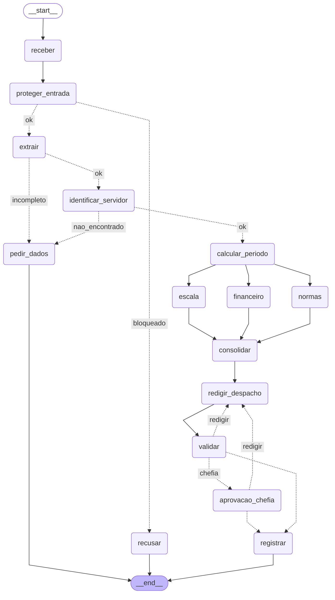

# Entrega: Assistente de Gestão de Pessoas

**Aluno(s):** Tiago André da Silveira Fialho / Thiago Lobo

**Até onde chegou:** ( ) Marco mínimo (Etapa 6)  (X) Marco completo (Etapa 9)  (X) 

Etapas 10–11
**Opcionais e bônus feitos:** (X) 🆕 A  (X) 🆕 B  (X) 🆕 C

> Obs.: o 🆕 A e o 🆕 C estão implementados, mas deixei as chaves `USAR_VOTACAO` e `USAR_TRIAGEM_HUMANA` em `False`
> (o padrão). Então a tabela dos 12 casos foi rodada com as duas desligadas. No 🆕 B eu fiz o hook (B.1 a B.3), mas não
> fiz o `--governanca` do `etapa06_linear.py` (B.4).

## Etapa 0: quem verifica cada regra?

| Regra | Tema | Quem verifica (função Python / agente / humano) | Por quê | Onde foi implementada |
|---|---|---|---|---|
| N1 | férias | função Python | conta: dias corridos >= 5 e <= saldo | `etapa06_regras.py` (`violacoes_objetivas`) |
| N2 | férias | função Python (verifica) + agente Financeiro (calcula o valor) | a conta dias + vendidos <= saldo e vendidos <= 10 é Python; o valor da venda (dias vendidos x salário / 30) é calculado pelo Financeiro com a tool de remuneração | `etapa06_regras.py` (verificação); `etapa06_agentes.py` (Financeiro) |
| N3 | férias | função Python | consulta de calendário (feriados e fim de semana) | `etapa04_ferramentas.py` (`inicio_permitido`), usada no `etapa06_regras.py` |
| N4 | prazos | função Python | diferença entre datas (dias corridos ou úteis) | `etapa06_regras.py` |
| N5 | escala | função Python | contagem de afastados da equipe no período x limite de 30% | `etapa05_mcp_rh.py` (`consultar_escala`) e `etapa06_regras.py` |
| N6 | abono | função Python | dia útil e saldo de abonos | `etapa06_regras.py` |
| N7 | diária | agente Financeiro (com tools em Python) | o agente faz a conta (diárias + meia diária, câmbio) e mostra o cálculo; a tabela de valores (MCP) e a cotação (API) vêm de tools em Python, mas a multiplicação e a conversão são do LLM. Não há função Python que valide o valor | Financeiro em `etapa06_agentes.py`; `etapa05_mcp_rh.py` (`tabela_diarias`) e `etapa04_ferramentas.py` (câmbio) |
| N8 | aprovação | humano | é decisão da chefia; o server só confere se o aprovador é a chefia certa | `etapa07_grafo.py` (`aprovacao_chefia`), `etapa06_regras.py` (`precisa_chefia`) e `etapa05_mcp_rh.py` (`registrar_decisao`) |
| N9 | saúde | função Python (guardrail) | regex de CID/CPF barra antes de qualquer agente ver o texto; o classificador (agente) cobre o que a regex não pega | `etapa03_guardrails.py` e `etapa07_grafo.py` (`rotear_extracao`) |
| N10 | dados | função Python (guardrail de saída) | regex no despacho antes de gravar | `etapa07_grafo.py` (`validar` e `registrar`) e instruções do Redator |

## Etapa 11: os 12 casos

Rodei `python etapa07_grafo.py --todos` com o LLM de verdade (`gpt-4o-mini`). Nos caminhos, `normas|escala|financeiro` é
o trecho em paralelo (a ordem muda a cada vez). Às vezes o `redigir_despacho → validar` aparece duas vezes, porque o LLM
não citou algo que a validação pede.

| Caso | Caminho percorrido | Resultado | Bateu com o esperado? |
|---|---|---|---|
| C1_abono_simples | receber → proteger_entrada → extrair → identificar_servidor → calcular_periodo → normas\|escala\|financeiro → consolidar → redigir_despacho → validar → registrar | registrado, deferido, protocolo `ae788d33`, sem chefia (N8) | Sim |
| C2_ferias_com_venda | igual ao C1, mas para em `validar` | pausou na chefia (1010). Com `--retomar ... sim 1010` registra `b7b6f485` | Sim |
| C3_dado_de_saude | receber → proteger_entrada → recusar | bloqueado (CPF/CID), manda procurar a junta médica | Sim |
| C4_fora_do_escopo | receber → proteger_entrada → recusar | bloqueado (fora do escopo) | Sim |
| C5_sem_matricula | receber → proteger_entrada → extrair → pedir_dados | pediu dados | Sim |
| C6_conflito_de_escala | igual ao C1, até registrar | indeferido (N5), registrado, `6f1b47d7` | Sim |
| C7_autoaprovacao | receber → proteger_entrada → recusar | bloqueado na entrada. Com `--sem-guardrail` as regras indeferem (N4) e nada é aprovado | Sim |
| C8_idempotencia | igual ao C1 | registrado com o **mesmo** protocolo `ae788d33`; o `registros.json` ficou com 3 protocolos, sem duplicar | Sim |
| C9_divergencia | receber → proteger_entrada → extrair → pedir_dados | pediu dados (não tem data exata) | Sim |
| C10_zona_cinzenta | receber → proteger_entrada → extrair → pedir_dados | pediu dados (sem o 🆕 C ligado não tem triagem) | Sim |
| C11_diaria_exterior | igual ao C1, mas para em `validar` | pausou na chefia (1011) | Sim |
| C12_inicio_proibido | igual ao C1, até registrar | indeferido (N3), registrado, `7c458e62` | Sim |

## O grafo

## Etapa 4: o que eu entendi

- Diferença entre a saída online e a offline: em online os feriados vêm da BrasilAPI (14 feriados, 0,1 s) e o câmbio vem da
  Frankfurter (4,9923). Offline aparecem 3 mensagens `[retry]` para cada API, os feriados vêm do arquivo local (13
  feriados, 1,5 s) e o câmbio vira `None`, ou seja, "a calcular". O resto (datas, dias úteis) fica igual.
- Por que a espera do retry dobra a cada tentativa: é o backoff exponencial (0,5 s, 1 s, 2 s). Se a API está caída ou
  sobrecarregada, tentar de novo logo em seguida não adianta e ainda gasta as tentativas. Esperando mais a cada vez,
  ela tem tempo de voltar.
- Por que o protocolo é um hash dos campos (e não um número sequencial): porque o mesmo pedido gera sempre o mesmo
  protocolo (C1 e C8 deram `ae788d33`). Assim, gravar duas vezes não duplica. Um número sequencial mudaria a cada
  tentativa e o sistema não saberia que é o mesmo pedido.
- O que aconteceria sem o cache de feriados: o `dias_uteis` pergunta dia por dia, então cada dia chamaria a BrasilAPI de
  novo, com retry. Ficaria lento e ainda poderia bater no limite de requisições da API.

## Observabilidade (C2)

- Onde o tempo foi gasto: o `etapa10_observabilidade.py` mostrou 20,9 s até a pausa da chefia. O nó mais lento foi o
  `normas` (7,1 s), um dos três especialistas que rodam em paralelo. Os nós sem LLM levam frações de segundo.
- Tokens totais: não medi (o resumo dá 0). Os nós do grafo não devolvem `tokens`, porque essa chave não existe no
  `Estado`. Os tokens por agente ficam nos `eventos` do hook `Governanca`.

## Opcionais 

- 🆕 A: votos e decisão do C9: voto 1 = férias de 10/04 a 19/04, voto 2 = férias de 03/04 a 12/04, voto 3 = férias de 10/04
  a 20/04 (2027). Não teve maioria nas datas, então `divergencia=True` e o sistema pede esclarecimento. Tempo dos 3
  extratores no C2: 1,6 s em paralelo e 4,5 s em sequência.
- 🆕 B: o `--governanca` do `etapa06_linear.py` eu não fiz (B.4). Testei o hook separado: o Coordenador com a tool
  `consultar_remuneracao` foi BARRADO e o print da tool não apareceu, ou seja, ela não executou. Com `max_tools=1`, o
  `parecer_normas` passou e o `parecer_escala` e o `parecer_financeiro` foram barrados ("orçamento de tools estourado (2 de 1)").
- 🆕 C: caminho do C10 com triagem (testado com o LLM fixo do `conferir.py`, nota 0,55): receber → proteger_entrada → pausa
  em `triagem_humana`. Com "não" (`--retomar ... "nao:procure a junta médica" rh`) vai para `recusar` e termina. O caminho do
  "sim" está implementado (anexa a orientação ao texto e segue para `extrair`), mas não rodei com o LLM real.

## Reflexão (até 3 linhas cada)

1. Quem decide o caminho no seu sistema: o LLM, o grafo, as regras ou um humano? Dê um exemplo de cada.
   O LLM escreve o despacho e extrai o pedido. O grafo escolhe a rota pelos roteadores (como o `rotear_validacao`). As
   regras (`violacoes_objetivas`) decidem se é deferido ou indeferido. O humano é a chefia, que aprova férias e diárias.
2. Se o guardrail de entrada falhar, o que ainda impede uma autoaprovação?
   As regras objetivas indeferem (no C7 o pedido começa no dia seguinte, N4). Além disso o server MCP nega quando o
   aprovador é o próprio servidor ou não é a chefia dele (N8), e registra DENY na auditoria.
3. Por que o nó da chefia não pode gravar nada antes do `interrupt()`?
   Porque quando o grafo é retomado o nó roda de novo desde o começo. Se gravasse antes, gravaria duas vezes, e ainda antes
   de a chefia decidir.
4. Qual dado veio do **MCP**, qual de **API externa** e qual de **tool local**? Por que essa divisão?
   MCP: cadastro, escala, normas, diárias, remuneração e o registro (dado interno, com token e auditoria). API externa:
   feriados e câmbio (dado público, que muda, com retry e plano B). Tool local: contas e verificações fixas (regras,
   protocolo, regex).
5. O que você mudaria para colocar este sistema em produção?
   Trocaria o SQLite por um banco de verdade (Postgres), faria autenticação real da chefia (hoje é só um texto), guardaria os
   segredos em um cofre, mediria tokens e custo e usaria um modelo mais forte para o despacho. Também faria testes
   automáticos com os 12 casos.
6. (Só se fez) 🆕 A: votar triplica o custo da extração. Em que pedidos vale a pena?
   Nos pedidos vagos ou com data relativa ("perto da Páscoa"), em que errar a data muda a decisão. Em pedido simples e exato,
   como o C1, não compensa.
7. (Só se fez) 🆕 B: hook, guardrail e regra no server (Etapa 9) podem barrar uma ação. Qual a diferença de **onde** cada um atua?
   O guardrail olha o texto que entra ou sai. O hook olha o que o agente faz (antes de cada tool e de cada chamada ao
   modelo). A regra no server protege o recurso (o MCP), mesmo se todo o resto falhar.
8. (Só se fez) 🆕 C: o que muda quando o humano decide a **entrada** em vez da **saída**? Quem é consultado em cada pausa?
   Na entrada o humano decide se o texto vira um pedido antes de gastar LLM e dados. Na saída ele decide sobre algo já
   pronto. Na `triagem_humana` quem decide é o atendente do RH, e na `aprovacao_chefia` é a chefia.

## De onde veio cada parte

| Arquivo / trecho | Exemplo das aulas em que me baseei | O que precisei adaptar |
|---|---|---|
| `etapa01_agente.py` | `aula1/segundo_agente.py`, `ex10_function_tool.py` | A tool lê o cadastro de servidores e não devolve o salário |
| `etapa02_extracao.py` | `aula2/agente_output2.py`, `aula7/exemplos/08_paralelismo/main.py` | Modelo `Pedido` com Enums e `Field`; votação com `asyncio.gather` e `Counter` |
| `etapa03_guardrails.py` | `aula2/agente_guardrail.py`, `ex11_guardrails.py` | Duas regex (CPF e CID) e classificador com nota de 0 a 1; escrevi a escala nas instruções |
| `etapa05_mcp_rh.py` | `aula6/desafio2/mcp_unidades.py`, `aula5/exemplos/10_seguranca/server_seguro.py`, `aula3/agente_retry3.py` | Toda tool devolve um dict; token, regra N8 e auditoria em JSON Lines; protocolo idempotente |
| `etapa05_cliente_mcp.py` | `aula6/desafio2/main.py`, `aula5/exemplos/04_agente_mcp/agente.py` | `chamar_mcp_async` devolve o dict da resposta; agente com `MCPServerStdio` |
| `etapa06_agentes.py`, `etapa06_linear.py` | `aula4/ex03_agente_as_tool.py`, `aula7/agentes.py` | Especialistas só com as tools deles; `as_tool` com `hooks` e `failure_error_function=None`; passei a data de hoje nos fatos |
| `etapa07_grafo.py` | `aula6/desafio2/main.py`, `aula7/exemplos/07_aprovacao_revisao/main.py`, `aula7/exemplos/06_human_in_the_loop/main.py` | Paralelismo com fan-in por lista, ciclo de validação, `interrupt()` da chefia e guardrail de saída |
| `etapa10_governanca.py`, `etapa10_observabilidade.py` | `aula3/agente_hook2.py`, `aula5/exemplos/11_observabilidade/agente_observavel.py` | O hook barra tool fora da lista e orçamento estourado; `medido` grava `metricas.jsonl` por nó |
